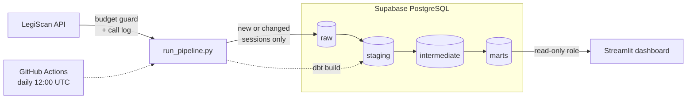

# Oklahoma Legislative Vote Tracker

An automated data pipeline and public dashboard showing how Oklahoma legislators vote when the two parties split.

**Live dashboard:** https://ok-legislative-tracker.streamlit.app

**Status:** Running daily on GitHub Actions with a hosted PostgreSQL database (Supabase), 37 passing dbt models and tests, and a public dashboard. Daily bill-level updates for the 2027 session are next.

| | |
|---|---|
| **Stack** | Python · PostgreSQL · dbt · GitHub Actions · Supabase · Streamlit |
| **Data** | [LegiScan API](https://legiscan.com/legiscan): 6,008 bills, 8,604 roll calls, 154 legislators (2026 session) |

## What it does

- **Finds Oklahoma's legislative sessions automatically**, so new sessions (like 2027) are picked up without code changes.
- **Downloads each session as one dataset file** and skips it when LegiScan's `dataset_hash` has not changed.
- **Checks for new data only after LegiScan publishes** (Sundays), so it runs daily while making about one dataset call a week.
- **Guards the API budget.** Every call goes through one client that waits between requests, logs the call to the database, and refuses to run past 8,000 calls a month (the free limit is 10,000).
- **Loads raw JSON into PostgreSQL** with upserts. Each session's hash is saved in the same transaction as its load, so a failed load is retried rather than skipped.
- **Transforms and tests with dbt** on every run. A failed test fails the run.
- **Publishes a dashboard** of party unity scores per legislator, per session, with the specific bills where each legislator voted against their party's majority.

## Architecture



One command runs the whole pipeline, locally or in GitHub Actions:

```bash
python src/run_pipeline.py
```

1. If LegiScan has published since the last check, call `getDatasetList` and find every session ending in 2026 or later.
2. For each session whose `dataset_hash` changed, download the dataset (a Base64-encoded ZIP), unzip it, and upsert every bill, roll call and person into the `raw` schema.
3. Run `dbt build`: create the models, run all tests, and grant the dashboard read access.

## Data model

| Layer | Models | What happens |
|---|---|---|
| staging | `stg_bills`, `stg_roll_calls`, `stg_votes`, `stg_people` | Flatten JSON, cast types, decode codes (chamber, bill status), flag carryover bills, classify each roll call as `committee`, `final_passage`, `veto_override`, `emergency` or `procedural` |
| intermediate | `int_party_positions` | Each party's majority position on every final passage vote, and whether the parties split |
| marts | `dim_legislators`, `fct_unity_votes`, `legislator_party_unity` | One row per legislator; one row per legislator per party-line vote; one party unity score per legislator per session |

`legislator_party_unity` is built from `fct_unity_votes`, so the scores and the vote lists on the dashboard always agree.

### Data tests

29 tests run on every build, including:

- Unique and not-null keys on every model
- Allowed values for chamber, party and vote category
- Every vote links to a real roll call and person; every roll call links to a real bill
- No legislator votes twice on one roll call
- **Vote rows reconcile with LegiScan's own yea/nay/absent totals for every roll call**
- One party unity row per legislator per session

## Security

- **Least privilege.** The pipeline uses an admin login stored in GitHub Secrets. The public dashboard uses a separate `dashboard_reader` role that can only `SELECT` from the transformed schemas. It has no access to raw data and cannot write anything. dbt re-applies these grants on every build.
- **No secrets in the repo.** API keys and passwords live in git-ignored `.env` files locally, GitHub Secrets for the pipeline, and Streamlit secrets for the dashboard. `dbt/profiles.yml` only reads environment variables.
- **The API key is never logged.** The call log stores the operation and its other parameters only.

## Findings

From the 2026 Regular Session ([full notes](docs/findings.md)):

- **565 of 3,131 final passage votes (18%) were party-line votes**, where most Republicans and most Democrats voted opposite ways.
- **Democrats voted "Nay" on final passage about twice as often as Republicans** (18.0% vs. 9.3%).
- **60% of roll calls were committee votes** (5,204 of 8,604), and 111 were veto override votes.
- **54% of the session's 6,008 bills were carried over from 2025.**
- **LegiScan has no topic tags for Oklahoma bills** (`subjects` is empty for all 6,008).

Party unity follows the definition used by [Voteview](https://voteview.com/articles/party_unity_scores). A lower score means a legislator voted with the other party's majority more often; the data alone does not explain why.

## Run it yourself

Requires Python 3.11+, PostgreSQL, and a free [LegiScan API key](https://legiscan.com/legiscan).

```bash
git clone https://github.com/777natalie/ok-legislative-tracker.git
cd ok-legislative-tracker
python3 -m venv .venv
source .venv/bin/activate
pip install -r requirements.txt
```

Create a `.env` file. The database settings are the standard PostgreSQL environment variables, read by Python, dbt and `psql`:

```
LEGISCAN_API_KEY=your_key_here
PGHOST=localhost
PGDATABASE=ok_legislature
PGUSER=your_username
```

Create the database and tables, and the role the dbt grants refer to:

```bash
createdb ok_legislature
psql ok_legislature -f sql/001_create_raw_tables.sql
psql ok_legislature -f sql/002_create_meta_tables.sql
psql ok_legislature -f sql/003_create_dataset_state.sql
psql ok_legislature -c "CREATE ROLE dashboard_reader;"
```

Run the pipeline, then the dashboard:

```bash
python src/run_pipeline.py --force
pip install -r app/requirements.txt
streamlit run app/dashboard.py
```

### Optional settings

| Variable | Default | Meaning |
|---|---|---|
| `LEGISCAN_STATE` | `OK` | State to track |
| `TRACK_FROM_YEAR` | `2026` | Track sessions ending in this year or later |
| `LEGISCAN_MONTHLY_LIMIT` | `8000` | Stop making API calls past this many in a month |
| `RAW_DIR` | `data/raw` | Where downloaded files are unzipped |

## Project structure

```
ok-legislative-tracker/
├── .github/workflows/
│   └── pipeline.yml         # daily scheduled run
├── src/
│   ├── legiscan_client.py   # every API call: budget guard, rate limit, call log
│   ├── run_pipeline.py      # discover sessions, download, load, dbt build
│   └── test_api.py          # quick check that the API key works
├── sql/                     # raw, meta and dataset-state tables
├── dbt/
│   ├── profiles.yml         # reads PG* environment variables
│   ├── models/
│   │   ├── staging/
│   │   ├── intermediate/
│   │   └── marts/
│   └── tests/               # custom data tests
├── app/
│   ├── dashboard.py         # Streamlit dashboard (reads marts)
│   └── requirements.txt
├── docs/
│   ├── findings.md          # what the data shows
│   └── PLAN.md              # where the project is going
└── requirements.txt         # pipeline dependencies
```

## Next steps

- [x] Hosted PostgreSQL (Supabase) and a daily GitHub Actions schedule
- [x] Public dashboard with a read-only database role
- [ ] Daily bill-level updates during session using LegiScan's `change_hash`, within the API budget
- [ ] CI checks on every push: unit tests for the API client and a dbt build
- [ ] Dashboard polish: links to each bill, legislator search

## Data credit

Legislative data provided by [LegiScan](https://legiscan.com), licensed under [Creative Commons Attribution 4.0](https://creativecommons.org/licenses/by/4.0/). This project is independent and not affiliated with LegiScan or the Oklahoma Legislature.