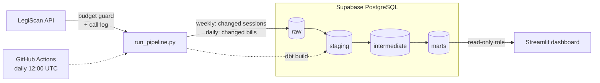

# Oklahoma Legislative Vote Tracker

An automated data pipeline and public dashboard showing how Oklahoma legislators vote when the two parties split.

[](https://github.com/777natalie/ok-legislative-tracker/actions/workflows/tests.yml)

**Live dashboard:** https://ok-legislative-tracker.streamlit.app

**Status:** Live. Runs daily on GitHub Actions against Supabase Postgres, fetching only what changed in LegiScan; any failing dbt data test fails the run. Every push runs the unit tests and rebuilds the schema and models on sample data in CI.

| | |
|---|---|
| **Stack** | Python · PostgreSQL · dbt · GitHub Actions · Supabase · Streamlit · pytest |
| **Data** | [LegiScan API](https://legiscan.com/legiscan): 6,008 bills, 8,604 roll calls, 154 legislators (2026 session) |

## What it does

- **Finds Oklahoma's legislative sessions automatically**, so new sessions (like 2027) are picked up without code changes.
- **Downloads each session as one dataset file** and skips it when LegiScan's `dataset_hash` has not changed.
- **Checks for new datasets only after LegiScan publishes** (Sundays), so it runs daily while making about one dataset call a week.
- **Updates changed bills daily.** One master list call returns every bill's `change_hash`; only bills whose hash changed are re-fetched, within a daily budget.
- **Keeps every version of every bill.** `raw.bill_versions` is append-only: a version is stored once and never updated or deleted, so status changes can be tracked over time.
- **Guards the API budget.** Every call goes through one client that checks the monthly count, waits between requests, and logs the call to the database. It refuses to run past 8,000 calls a month (the free limit is 10,000), and the daily bill updates spread the remaining calls over the rest of the month, keeping 50 in reserve for the weekly dataset job.
- **Loads raw JSON into PostgreSQL** with upserts, so re-running never duplicates data. Each session's hash is saved in the same transaction as its load, so a failed load is retried rather than skipped, and each updated bill is committed on its own.
- **Transforms and tests with dbt** on every run. A failed test fails the run.
- **Publishes a dashboard** of party unity scores per legislator, per session, with the specific bills where each legislator voted against their party's majority.

## Architecture



One command runs the whole pipeline, locally or in GitHub Actions:

```bash
python src/run_pipeline.py
```

1. **Weekly datasets.** If LegiScan has published since the last check, call `getDatasetList`, find every session ending in 2026 or later, and download each session whose `dataset_hash` changed (a Base64-encoded ZIP). Every bill, roll call and person is upserted into the `raw` schema.
2. **Daily bill updates.** Call `getMasterListRaw` once, compare each bill's `change_hash` with the stored one, and call `getBill` for changed or new bills, up to today's budget. Bills left over are picked up on later runs.
3. **Transform and test.** Run `dbt build`: create the models, run all data tests, and grant the dashboard read access.

## Data model

| Layer | Models | What happens |
|---|---|---|
| staging | `stg_bills`, `stg_roll_calls`, `stg_votes`, `stg_people`, `stg_bill_versions`, `stg_bill_actions` | Flatten JSON, cast types, decode codes (chamber, bill status), flag carryover bills, classify each roll call as `committee`, `final_passage`, `veto_override`, `emergency` or `procedural`, and list each bill's official actions in order |
| intermediate | `int_party_positions` | Each party's majority position on every final passage vote, and whether the parties split |
| marts | `dim_legislators`, `fct_unity_votes`, `legislator_party_unity`, `fct_bill_changes` | One row per legislator; one row per legislator per party-line vote; one party unity score per legislator per session; one row per bill version compared with the version before it (status changes, new actions) |

`legislator_party_unity` is built from `fct_unity_votes`, so the scores and the vote lists on the dashboard always agree.

## Testing

### Data tests (dbt)

37 data tests run on every pipeline run and in CI, including:

- Unique and not-null keys on every model
- Allowed values for chamber, party and vote category
- Every vote links to a real roll call and person; every roll call links to a real bill
- No legislator votes twice on one roll call
- **Vote rows reconcile with LegiScan's own yea/nay/absent totals for every roll call**
- One row per bill version, per bill action, and per legislator per session

### Unit tests (pytest)

17 tests in `tests/` cover the logic that decides what to fetch and how many API calls to spend. They use fakes for the database and HTTP, so they never call LegiScan or touch a real database.

| File | What it checks |
|---|---|
| `test_call_api.py` | At the monthly limit, no request is sent. Every call, including failed ones, is logged before an error is raised. The API key is sent but never logged. |
| `test_budget.py` | The daily budget is capped, spread over the days left in the month, keeps 50 calls in reserve, and is never negative. |
| `test_change_detection.py` | Unchanged bills are skipped; changed and new bills are fetched, in `bill_id` order. |
| `test_dataset_schedule.py` | The weekly dataset check uses the right Sunday publication time, including just before and at publication. |

### Continuous integration

`.github/workflows/tests.yml` runs on every push and pull request, with no secrets:

1. **pytest:** the 17 unit tests.
2. **dbt:** starts a throwaway PostgreSQL, applies every migration in `sql/`, loads a small sample of real LegiScan data (`tests/fixtures/`: 2 bills, 7 roll calls, 154 legislators) twice to check that reloading changes nothing, then runs `dbt build`. This catches broken migrations, broken upserts and broken models before they reach the production database.

## Security

- **Least privilege.** The pipeline uses an admin login stored in GitHub Secrets. The public dashboard uses a separate `dashboard_reader` role that can only `SELECT` from the transformed schemas. It has no access to raw data and cannot write anything. dbt re-applies these grants on every build.
- **No secrets in the repo.** API keys and passwords live in git-ignored `.env` files locally, GitHub Secrets for the pipeline, and Streamlit secrets for the dashboard. `dbt/profiles.yml` only reads environment variables. The CI workflow uses no secrets, and its token can only read the repository.
- **The API key is never logged.** The call log stores the operation and its other parameters only. A unit test enforces this.

## Findings

From the 2026 Regular Session ([full notes](docs/findings.md)):

- **565 of 3,131 final passage votes (18%) were party-line votes**, where most Republicans and most Democrats voted opposite ways.
- **Democrats voted "Nay" on final passage about twice as often as Republicans** (18.0% vs. 9.3%).
- **60% of roll calls were committee votes** (5,204 of 8,604), and 111 were veto override votes.
- **54% of the session's 6,008 bills were carried over from 2025.**
- **LegiScan has no topic tags for Oklahoma bills** (`subjects` is empty for all 6,008).

Party unity follows the definition used by [Voteview](https://voteview.com/articles/party_unity_scores). A lower score means a legislator voted with the other party's majority more often; the data alone does not explain why.

## Run it yourself

Requires Python 3.11+, PostgreSQL, and a free [LegiScan API key](https://legiscan.com/legiscan).

```bash
git clone https://github.com/777natalie/ok-legislative-tracker.git
cd ok-legislative-tracker
python3 -m venv .venv
source .venv/bin/activate
pip install -r requirements-dev.txt
```

Create a `.env` file. The database settings are the standard PostgreSQL environment variables, read by Python, dbt and `psql`:

```
LEGISCAN_API_KEY=your_key_here
PGHOST=localhost
PGDATABASE=ok_legislature
PGUSER=your_username
```

Create the database, apply the migrations in order, and create the role the dbt grants refer to:

```bash
createdb ok_legislature
for f in sql/*.sql; do psql ok_legislature -v ON_ERROR_STOP=1 -f "$f"; done
psql ok_legislature -c "CREATE ROLE dashboard_reader;"
```

Check that your API key works (uses one API call), then run the pipeline and the dashboard:

```bash
python src/check_api_key.py
python src/run_pipeline.py --force
pip install -r app/requirements.txt
streamlit run app/dashboard.py
```

Run the unit tests (no API key or database needed):

```bash
python -m pytest -v
```

### Optional settings

| Variable | Default | Meaning |
|---|---|---|
| `LEGISCAN_STATE` | `OK` | State to track |
| `TRACK_FROM_YEAR` | `2026` | Track sessions ending in this year or later |
| `LEGISCAN_MONTHLY_LIMIT` | `8000` | Stop making API calls past this many in a month |
| `MAX_BILLS_PER_RUN` | `200` | Most bills the daily update fetches in one run |
| `RAW_DIR` | `data/raw` | Where downloaded files are unzipped |

## Project structure

```
ok-legislative-tracker/
├── .github/workflows/
│   ├── pipeline.yml         # daily scheduled run
│   └── tests.yml            # unit tests + full database rebuild on every push
├── src/
│   ├── legiscan_client.py   # every API call: budget guard, rate limit, call log
│   ├── run_pipeline.py      # weekly datasets, daily bill updates, dbt build
│   ├── update_bills.py      # daily change_hash comparison and bill updates
│   ├── check_api_key.py     # one-call check that the API key works
│   └── probe_masterlist.py  # one-off exploration of the master list
├── sql/                     # migrations, applied in numeric order
├── dbt/
│   ├── profiles.yml         # reads PG* environment variables
│   ├── models/
│   │   ├── staging/
│   │   ├── intermediate/
│   │   └── marts/
│   └── tests/               # custom data tests
├── tests/                   # pytest unit tests
│   ├── fixtures/            # small LegiScan sample used in CI
│   └── load_sample_data.py  # loads the sample in CI before dbt build
├── app/
│   ├── dashboard.py         # Streamlit dashboard (reads marts)
│   └── requirements.txt
├── docs/
│   ├── findings.md          # what the data shows
│   └── PLAN.md              # where the project is going
├── requirements.txt         # pipeline dependencies
└── requirements-dev.txt     # pipeline dependencies + pytest
```

## Known limitations

- **One pipeline run at a time.** The budget check counts this month's calls and then makes the call. That is safe with a single scheduled run; two runs at once could both pass the check.
- **Daily updates go in `bill_id` order.** If more bills change than the daily budget allows for several days in a row, the highest `bill_id`s wait the longest. This only matters in the busiest weeks of a session.
- **GitHub disables scheduled workflows after 60 days without repository activity** on public repos, so the daily run needs an occasional commit or a manual run.

## Next steps

- [x] Hosted PostgreSQL (Supabase) and a daily GitHub Actions schedule
- [x] Public dashboard with a read-only database role
- [x] Daily bill-level updates using LegiScan's `change_hash`, within the API budget
- [x] Append-only bill version history and bill change log
- [x] CI on every push: unit tests and a full database rebuild with dbt
- [ ] Dashboard polish: links to each bill, legislator search
- [ ] Read-only views and access rules for a future mobile app

## Data credit

Legislative data provided by [LegiScan](https://legiscan.com), licensed under [Creative Commons Attribution 4.0](https://creativecommons.org/licenses/by/4.0/). This includes the sample files in `tests/fixtures/`. This project is independent and not affiliated with LegiScan or the Oklahoma Legislature.
