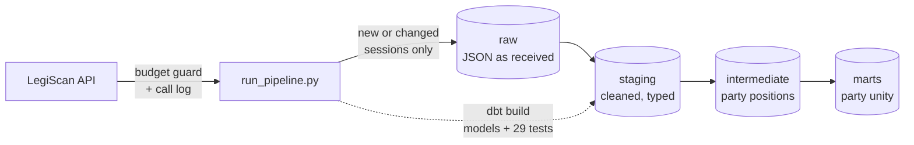

# Oklahoma Legislative Vote Tracker

A data pipeline that collects every bill, roll-call vote and legislator in the Oklahoma Legislature, loads it into PostgreSQL, models it with dbt and tests it for quality.

**Status:** Early development. Extract, load and transform work locally with 29 passing data tests. Hosted database, scheduling and a dashboard are next.

## What it does today

- **Finds Oklahoma's legislative sessions automatically** from the LegiScan API, so new sessions (like 2027) are picked up without code changes.
- **Downloads each session as one dataset file** and skips it when LegiScan's `dataset_hash` has not changed.
- **Checks for new data only after LegiScan publishes** (Sundays), so it can run daily while making about one dataset call a week.
- **Guards the API budget.** Every call goes through one client that waits between requests, logs the call to the database, and refuses to run past 8,000 calls a month (LegiScan's free limit is 10,000).
- **Loads raw JSON into PostgreSQL** with upserts, so rerunning never creates duplicates. Each session's hash is saved in the same transaction as its load.
- **Transforms with dbt** into staging, intermediate and mart layers, and tests the data on every run.
- **Calculates a party unity score** for each legislator, per session.

## How it works



One command runs everything:

```bash
python src/run_pipeline.py
```

1. If LegiScan has published since the last check, call `getDatasetList` and find every session ending in 2026 or later.
2. For each session whose `dataset_hash` changed, download the dataset (a Base64-encoded ZIP), unzip it, and upsert every bill, roll call and person into the `raw` schema.
3. Run `dbt build`: create the models and run all data tests. If a test fails, the run fails.

## Data model

| Layer | Models | What happens |
|---|---|---|
| staging | `stg_bills`, `stg_roll_calls`, `stg_votes`, `stg_people` | Flatten JSON, cast types, decode codes (chamber, bill status), classify each roll call (`committee`, `final_passage`, `veto_override`, `emergency`, `procedural`) |
| intermediate | `int_party_positions` | Each party's majority position on every final passage vote, and whether the parties split |
| marts | `legislator_party_unity` | One row per legislator per session with their party unity score |

**Data tests (29)** include: unique and not-null keys, allowed values, every vote linked to a real roll call and person, every roll call linked to a real bill, no legislator voting twice on one roll call, and **vote rows reconciling with LegiScan's own yea/nay/absent totals for every roll call**.

## Findings so far

From the 2026 Regular Session ([full notes](docs/findings.md)):

- **565 of 3,131 final passage votes (18%) were party-line votes**, where most Republicans and most Democrats voted opposite ways.
- **Democrats voted "Nay" on final passage about twice as often as Republicans** (18.0% vs. 9.3%).
- **54% of the session's 6,008 bills were carried over from 2025.**
- **LegiScan has no topic tags for Oklahoma bills** (`subjects` is empty for all 6,008).

Party unity follows the definition used by [Voteview](https://voteview.com/articles/party_unity_scores). A low score means a legislator often voted with the other party's majority; the data alone does not explain why.

## Run it yourself

Requires Python 3.11+, PostgreSQL, and a free [LegiScan API key](https://legiscan.com/legiscan).

```bash
git clone https://github.com/777natalie/ok-legislative-tracker.git
cd ok-legislative-tracker
python3 -m venv .venv
source .venv/bin/activate
pip install -r requirements.txt
```

Create a `.env` file:

```
LEGISCAN_API_KEY=your_key_here
DATABASE_URL=postgresql://localhost/ok_legislature
```

Create the database and tables:

```bash
createdb ok_legislature
psql ok_legislature -f sql/001_create_raw_tables.sql
psql ok_legislature -f sql/002_create_meta_tables.sql
psql ok_legislature -f sql/003_create_dataset_state.sql
```

Set up a dbt profile named `ok_legislature` in `~/.dbt/profiles.yml` pointing at the same database, then:

```bash
python src/run_pipeline.py --force
```

### Optional settings

| Variable | Default | Meaning |
|---|---|---|
| `LEGISCAN_STATE` | `OK` | State to track |
| `TRACK_FROM_YEAR` | `2026` | Track sessions ending in this year or later |
| `LEGISCAN_MONTHLY_LIMIT` | `8000` | Stop making API calls past this many in a month |
| `RAW_DIR` | `data/raw` | Where downloaded files are unzipped |

## Project structure

```
ok-legislative-tracker/
├── src/
│   ├── legiscan_client.py   # every API call: budget guard, rate limit, call log
│   ├── run_pipeline.py      # discover sessions, download, load, dbt build
│   └── test_api.py          # quick check that the API key works
├── sql/                     # raw, meta and dataset-state tables
├── dbt/
│   ├── models/
│   │   ├── staging/
│   │   ├── intermediate/
│   │   └── marts/
│   └── tests/               # custom data tests
├── docs/
│   ├── findings.md          # what the data shows
│   └── PLAN.md              # where the project is going
└── requirements.txt
```

## Next steps

- [ ] Hosted PostgreSQL (Supabase) and a daily GitHub Actions schedule
- [ ] Daily incremental updates during session using LegiScan's `change_hash`, within the API budget
- [ ] A public dashboard of legislators' voting records

The full plan is in [docs/PLAN.md](docs/PLAN.md).

## Data credit

Legislative data provided by [LegiScan](https://legiscan.com), licensed under [Creative Commons Attribution 4.0](https://creativecommons.org/licenses/by/4.0/). This project is independent and not affiliated with LegiScan or the Oklahoma Legislature.