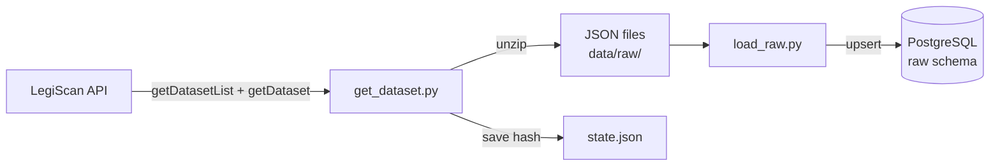

# Oklahoma Legislative Vote Tracker

A data pipeline that collects every bill, roll-call vote and legislator in the Oklahoma Legislature and loads it into PostgreSQL for analysis.

**Status:** Early development. The extract and load steps work; transformation, automation and a dashboard are next.

## What it does today

- **Pulls the legislator list** for the 2026 Regular Session (154 people) from the LegiScan API and writes it to CSV.
- **Downloads the full 2026 session** (6,008 bills, 8,604 roll calls, 154 people) as one dataset file, using 2 API queries.
- **Skips unchanged downloads.** The pipeline stores LegiScan's `dataset_hash` and only downloads again when the hash changes.
- **Loads the raw JSON into PostgreSQL** (`raw.bills`, `raw.roll_calls`, `raw.people`) with upserts, so rerunning the load never creates duplicates.

## How it works



1. `get_dataset.py` checks the session's `dataset_hash`. If it is new, it downloads the session ZIP (sent as Base64 inside JSON), unzips it, and saves the hash.
2. `load_raw.py` reads every bill, roll call and person file and upserts each one into a `JSONB` column in Postgres, keeping the data exactly as received.

Cleaning and modeling happen in later steps, inside the database (ELT).

## Early findings

From profiling the 2026 session data ([full notes](docs/findings.md)):

- **60% of roll calls are committee votes** (5,204 of 8,604).
- **Two out of three floor votes had at least one "nay"** (only 33.1% had zero nays), compared with 62.3% of committee votes.
- **111 roll calls were veto override votes.**
- **Bills from 2025 carry over** into the 2026 session under new IDs, which matters for counting bills correctly.

## Run it yourself

Requires Python 3.11+, PostgreSQL, and a free [LegiScan API key](https://legiscan.com/legiscan).

```bash
git clone https://github.com/YOUR-USERNAME/ok-legislative-tracker.git
cd ok-legislative-tracker
python3 -m venv .venv
source .venv/bin/activate
pip install -r requirements.txt
```

Create a `.env` file:

```
LEGISCAN_API_KEY=your_key_here
DATABASE_URL=postgresql://localhost/ok_legislature
```

Then:

```bash
createdb ok_legislature
psql ok_legislature -f sql/001_create_raw_tables.sql
python src/get_dataset.py
python src/load_raw.py
```

## Project structure

```
ok-legislative-tracker/
├── src/
│   ├── test_api.py          # first API connection test
│   ├── get_legislators.py   # legislators to CSV
│   ├── get_dataset.py       # full session download with hash check
│   └── load_raw.py          # JSON into Postgres raw tables
├── sql/
│   └── 001_create_raw_tables.sql
├── docs/
│   ├── findings.md          # what the data shows so far
│   └── PLAN.md              # where the project is going
├── requirements.txt
└── data/                    # downloaded files (not committed)
```

## Next steps

- [ ] dbt models that turn the raw JSON into clean tables, with data tests
- [ ] Daily automated updates using LegiScan's `change_hash`
- [ ] A public dashboard of legislators' voting records

The full plan is in [docs/PLAN.md](docs/PLAN.md).

## Data credit

Legislative data provided by [LegiScan](https://legiscan.com), licensed under [Creative Commons Attribution 4.0](https://creativecommons.org/licenses/by/4.0/). This project is independent and not affiliated with LegiScan or the Oklahoma Legislature.