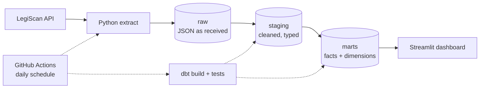
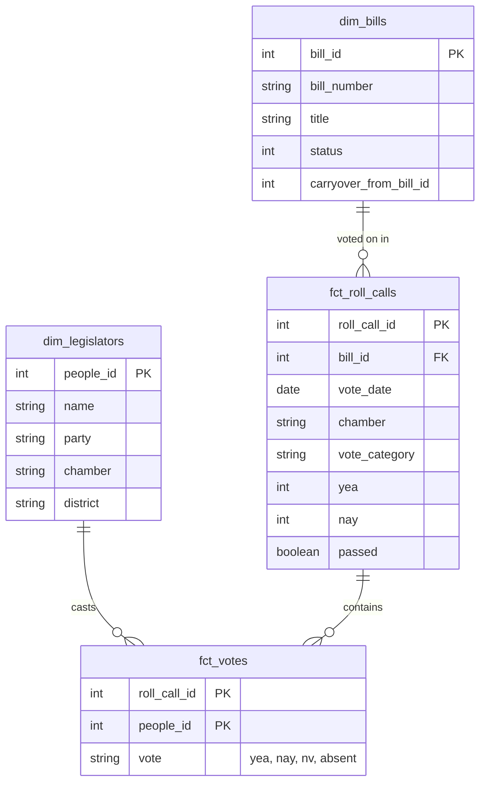

# Project plan

Where this project is going. Nothing below this line is built yet unless it is checked off in the roadmap.

**Goal:** a tested, automated pipeline and a public dashboard of Oklahoma legislators' voting records, live when the 2027 session opens on Monday, February 1, 2027.

## Roadmap

| # | Milestone | Target | Status |
|---|---|---|---|
| 0 | API key, repo, first API call | Oct 25 | Done |
| 1 | Pull legislators to CSV | Nov 1 | Done |
| 2 | Download full session dataset with `dataset_hash` check | Nov 8 | Done |
| 3 | Load raw JSON into PostgreSQL | Nov 15 | Done |
| 4 | dbt staging and mart models, with tests | Nov 29 | Next |
| 5 | Daily incremental updates on GitHub Actions, hosted Postgres | Dec 6 | |
| 6 | Streamlit dashboard, deployed | Dec 20 | |
| 7 | Documentation pass: diagrams, dbt docs | Jan 10 | |
| Live | Running for the 2027 session | Feb 1, 2027 | |

**Stretch goals** (only after the core works): Docker packaging · CI workflow with pytest · legislator history tracking (SCD Type 2) · Open States as a second source to cross-check vote totals · bill topic tagging · Spanish bill summaries.

## Target architecture

The project follows ELT: load raw data first, transform inside the database with dbt. A bug in a transformation is fixed by rerunning dbt, without spending API queries.

## Daily updates (Milestone 5)

LegiScan's free tier allows 10,000 queries a month at about 2 requests per second. Its documentation says to use hashes to avoid repeat downloads.

1. Call `getMasterListRaw` (1 query) to get every bill's current `change_hash`.
2. Compare with the hashes stored in Postgres.
3. Call `getBill` only for bills whose hash changed.
4. Call `getRollCall` only for roll calls not already stored (roll calls never change once taken).
5. Run `dbt build`.

**Hashes move into the database.** Locally they live in `data/state.json`, but GitHub Actions starts with an empty machine every run, so from Milestone 5 they live in a Postgres table.

**Query budget:** not measured yet. Each run will log how many queries it used, and the estimate will come from real numbers.

## dbt models (Milestone 4)

Layers follow [dbt's recommended structure](https://docs.getdbt.com/best-practices/how-we-structure/1-guide-overview).

| Layer | Models | What happens |
|---|---|---|
| Staging | `stg_bills`, `stg_roll_calls`, `stg_votes`, `stg_people`, `stg_bill_sponsors` | Flatten JSON, rename, cast types (`passed` 1/0 to boolean, `party_id` to integer), decode `chamber` S/H, add `vote_category` |
| Marts | `dim_legislators`, `dim_bills`, `fct_roll_calls`, `fct_votes` | Star schema for analysis |
| Metrics | `legislator_scorecard` | Party unity, attendance, per legislator |

**`vote_category`**, based on the descriptions found in [findings.md](findings.md):

| Category | Rule |
|---|---|
| committee | `desc` contains "Committee" |
| final_passage | `THIRD READING` or `FOURTH READING` |
| veto_override | contains `VETO OVERRIDE` |
| emergency | `EMERGENCY` (not a veto override) |
| procedural | everything else |

### Planned data model

## Metrics

| Metric | Definition |
|---|---|
| Party unity vote | A final passage roll call where most Republicans voted opposite most Democrats, counting only yea and nay. Adapted from [Voteview](https://voteview.com/articles/party_unity_scores). |
| Party unity score | Of the party unity votes a legislator voted yea or nay on, the share where they voted with their party's majority. |
| Attendance rate | Final passage roll calls where the legislator voted yea or nay, divided by all final passage roll calls in their chamber while they served. |

Open question: if party unity votes turn out to be rare, the more useful measure may be how often a legislator votes against the majority of their own party.

## Testing

| Test | Where | Rule |
|---|---|---|
| Primary keys unique and not null | dbt | `roll_call_id`, `bill_id`, `people_id` |
| One vote per legislator per roll call | dbt | Unique on (`roll_call_id`, `people_id`) |
| Votes point to real records | dbt `relationships` | Every vote's `roll_call_id` and `people_id` exist |
| Allowed values | dbt `accepted_values` | `chamber` in (House, Senate); `vote_category` in the five categories |
| Vote counts reconcile | Custom dbt test | Rows in `fct_votes` per roll call match LegiScan's `yea`, `nay`, `nv`, `absent` |
| API errors stop the run | pytest | `call_api` raises when `status` is not `"OK"` |
| Unchanged hash skips download | pytest | No download when `dataset_hash` matches |

## Known risks

- **GitHub disables scheduled workflows after 60 days with no repository activity** on public repos.
- **Supabase's free tier pauses inactive projects.** Daily runs should keep it active; check before relying on it.
- **Carryover bills** appear under a new `bill_id` each session. Counts across sessions must link them.
- **LegiScan's terms:** one API key per person, no scraping legiscan.com, always credit LegiScan.

## Later: part of Centlāliā

This data could power the state-legislature part of Centlāliā (vote tracker, "who represents me," matching officials by what they do). The person records already include photos, office addresses, phone numbers and cross-reference IDs (VoteSmart, Ballotpedia). If both projects use the same Supabase database, Centlāliā can read shared views directly; a separate API is not needed unless a real need appears.